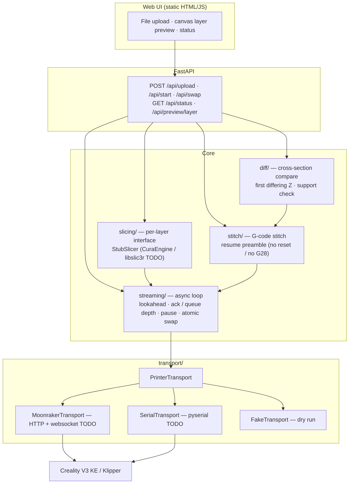
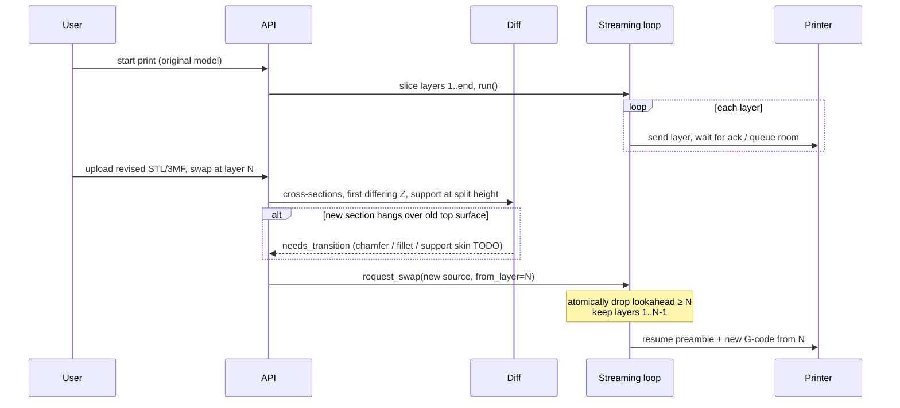

# LayerStream Slicer

A web-based slicer for the **Creality K1 / Ender-3 V3 KE** (Klipper + Moonraker) that streams G-code **layer by layer** instead of uploading a complete file.

The headline feature is a **mid-print model swap**: while layers `1..N-1` are already on the bed, you upload a revised STL or 3MF. The backend diffs it against the in-progress model, and from a chosen layer `N` upward it streams new G-code, leaving the printed layers alone.

The streaming loop, model diff, **CuraEngine per-layer slicing** (Creality V3 KE profile), **Moonraker and serial transports**, **G-code seam stitch**, **Klipper resume preamble**, and **chamfer/support-skin transition geometry** are implemented. A **fake dry-run transport** is still available when no printer is connected. `StubSlicer` is used only when no engine is installed.

## Architecture



Mid-print swap sequence:



## Project layout

```
src/layerstream_slicer/
  api/          FastAPI app (upload, start, pause/resume, swap, status, preview)
  diff/         Mesh load, Z cross-sections, first-difference, support check
  slicing/      LayerSlicer protocol + StubSlicer
  stitch/       G-code stitch + Klipper resume preamble stub
  streaming/    Layer sources + StreamController loop
  transport/    PrinterTransport, Moonraker, serial, FakeTransport
  web/          Static HTML/JS UI (upload, canvas preview, status)
tests/          pytest coverage for diff + streaming (fake transport)
```

## Quick start

```bash
python -m venv .venv
source .venv/bin/activate
pip install -e ".[dev]"
pytest
layerstream-slicer   # http://127.0.0.1:8000  — dry-run UI
```

The UI can start a **fake dry-run**, stream to a **Moonraker** host, or use a **serial** port. Layer preview can draw either a mesh cross-section or the sliced G-code toolpath. `GET /api/slicer` reports whether CuraEngine (or PrusaSlicer) is available.

## Printer transports

- **Moonraker** — HTTP `/printer/gcode/script` and `/printer/objects/query`, plus a websocket JSON-RPC session (`printer.objects.subscribe`, `notify_gcode_response`, `notify_status_update`) with automatic reconnect. Configure the host as `http://printer:7125` (default port 7125).
- **Serial** — pyserial, line numbers + checksums, wait-for-`ok`, resend on timeout or `Resend: N`. DTR is held low so opening the port does not reset the MCU.
- **Fake** — in-memory dry run used by tests and the default UI path.

## Streaming loop

`StreamController` pulls layers from a `LayerSource`, keeps a small lookahead buffer, and only sends when `transport.queue_depth()` is below `max_queue_depth`. After each send it waits for `wait_for_ack()`.

- **Pause / resume** — the loop parks between layers and also calls `transport.pause()` / `resume()`.
- **Swap at layer N** — `request_swap(new_source, from_layer=N)` is applied atomically inside the loop: the current source is wrapped in a `SplicedLayerSource` (layers `< N` stay on the old source, `≥ N` come from the new one) and any lookahead entries at or past `N` are discarded so a stale old layer cannot slip through.

## Model diff

`diff.detect` loads STL/3MF with `trimesh`, cuts each mesh at given Z heights, and turns the sections into `shapely` polygons.

- `first_difference` reports the first Z (and layer) whose symmetric-difference area exceeds a tolerance.
- `support_at_split` checks whether the **new** cross-section at the split height is covered by the **old** top surface. Unsupported area (`new.difference(old)`) sets `needs_transition=True`.

## What still is not a full slicer product

- Engines still slice the **whole mesh** and then we keep layers `N..end`; there is no native “slice only from layer N” hook in CuraEngine.
- Transition skins are planned (polygons + flags) but not yet extruded back into the G-code stream automatically.
- Moonraker/serial printer integration is implemented and tested against mocks; a live V3 KE still needs a reachable Moonraker or serial device.

## License

No license has been chosen yet; treat this scaffold as source-available until one is added.
