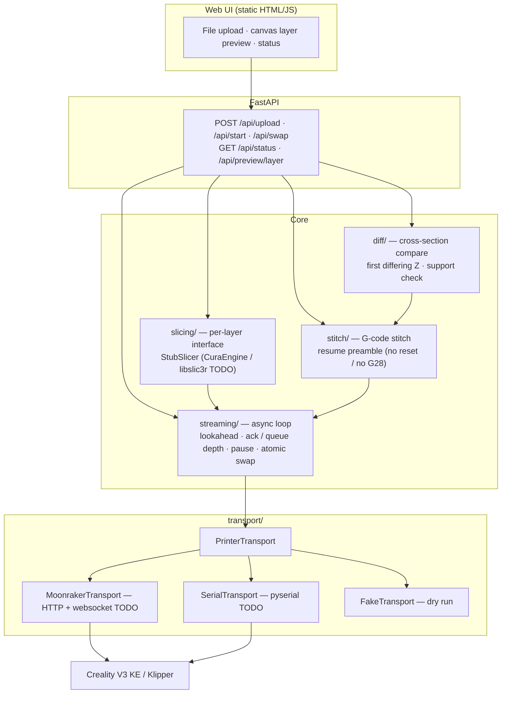
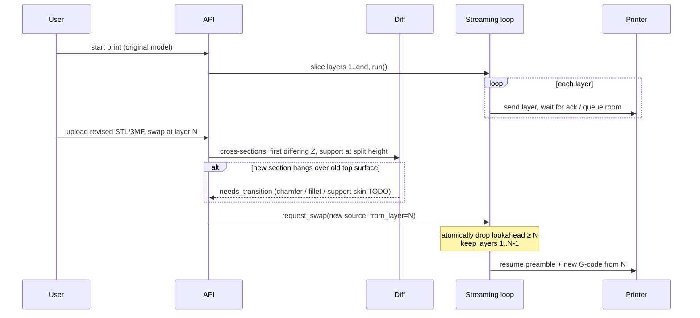

# LayerStream Slicer

A web-based slicer for the **Creality K1 / Ender-3 V3 KE** (Klipper + Moonraker) that streams G-code **layer by layer** instead of uploading a complete file.

The headline feature is a **mid-print model swap**: while layers `1..N-1` are already on the bed, you upload a revised STL or 3MF. The backend diffs it against the in-progress model, and from a chosen layer `N` upward it streams new G-code, leaving the printed layers alone.

This repository is the initial scaffold. Slicing engines, the real Moonraker/serial transports, transition geometry, and firmware resume are stubbed with explicit TODOs. A **fake dry-run transport** lets the streaming loop run end to end, and the diff module already compares meshes with `trimesh` + `shapely`.

## Architecture



Mid-print swap sequence:



## Project layout

```
src/layerstream_slicer/
  api/          FastAPI app (upload, start, pause/resume, swap, status, preview)
  diff/         Mesh load, Z cross-sections, first-difference, support check
  slicing/      LayerSlicer protocol + StubSlicer
  stitch/       G-code stitch + Klipper resume preamble stub
  streaming/    Layer sources + StreamController loop
  transport/    PrinterTransport, Moonraker, serial, FakeTransport
  web/          Static HTML/JS UI (upload, canvas preview, status)
tests/          pytest coverage for diff + streaming (fake transport)
```

## Quick start

```bash
python -m venv .venv
source .venv/bin/activate
pip install -e ".[dev]"
pytest
layerstream-slicer   # http://127.0.0.1:8000  — dry-run UI
```

The default start path uses `FakeTransport`. Moonraker and serial endpoints return HTTP 501 until those transports are implemented.

## Streaming loop

`StreamController` pulls layers from a `LayerSource`, keeps a small lookahead buffer, and only sends when `transport.queue_depth()` is below `max_queue_depth`. After each send it waits for `wait_for_ack()`.

- **Pause / resume** — the loop parks between layers and also calls `transport.pause()` / `resume()`.
- **Swap at layer N** — `request_swap(new_source, from_layer=N)` is applied atomically inside the loop: the current source is wrapped in a `SplicedLayerSource` (layers `< N` stay on the old source, `≥ N` come from the new one) and any lookahead entries at or past `N` are discarded so a stale old layer cannot slip through.

## Model diff

`diff.detect` loads STL/3MF with `trimesh`, cuts each mesh at given Z heights, and turns the sections into `shapely` polygons.

- `first_difference` reports the first Z (and layer) whose symmetric-difference area exceeds a tolerance.
- `support_at_split` checks whether the **new** cross-section at the split height is covered by the **old** top surface. Unsupported area (`new.difference(old)`) sets `needs_transition=True`.

## Main TODOs

- **Per-layer slicing** — wrap CuraEngine and/or libslic3r so a swap can reslice from layer `N` without redoing `1..N-1`.
- **Transition geometry** — when `needs_transition`, auto-build chamfer / fillet / support skin (or flag the user and wait).
- **G-code stitch** — real seam handling (retract/prime, wipe, Z-hop, extrusion-mode match) in `stitch/`.
- **Firmware resume** — restore bed mesh (`BED_MESH_PROFILE LOAD=...`), temperatures, and position **without** `G28` / `FIRMWARE_RESTART`.
- **MoonrakerTransport** — HTTP script send + websocket acknowledgements and queue depth.
- **SerialTransport** — pyserial (do not toggle DTR in a way that resets the MCU).

## License

No license has been chosen yet; treat this scaffold as source-available until one is added.
