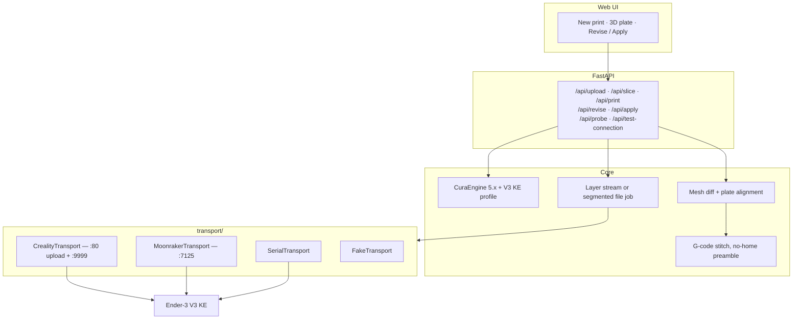

# LayerStream Slicer

A web-based slicer for the **Creality Ender-3 V3 KE** that can start a print and then **revise the model mid-print**. Already-printed layers stay on the bed; only unprinted G-code from the first changed layer is replaced. Plate placement is verified so the new toolpaths land on the same XY as the original.

Stock KE firmware (OrcaSlicer Host Type **CrealityPrint**) does **not** expose Moonraker on port 7125 unless the printer is rooted. This project talks to that stock stack the same way Orca does: HTTP upload on port 80 and a JSON websocket on port **9999**.

## Update on Windows (Python 3.14)

From the repo directory, with the existing venv:

```bat
git pull
.\.venv\Scripts\pip install -e ".[dev]"
.\.venv\Scripts\layerstream-slicer.exe probe 192.168.68.72
.\.venv\Scripts\layerstream-slicer.exe
```

Then open http://127.0.0.1:8000. Put the printer IP in the header, click **Test connection**, load an STL/3MF, set the Orca-style groups (Ender-3 V3 KE 0.4 defaults), **Slice**, then **Send to print**. To change the model later, open **2. Revise**, upload the new file, review the highlighted first changed layer, and press **Apply changes**.

CuraEngine is taken from `CURAENGINE` if set, otherwise from `PATH`, otherwise from `C:\Program Files\UltiMaker Cura *\CuraEngine.exe`. Cura 5.14 definitions are loaded from that install’s `share\cura\resources\definitions` (and `extruders`) via `CURA_ENGINE_SEARCH_PATH`. Vendored Cura 5.0 defs are a fallback (used on Linux with the Debian `cura-engine` package).

## Probe

```bash
layerstream-slicer probe 192.168.68.72
```

Tries Moonraker on `:7125`, then Creality `GET /info` on port 80 and the websocket on `:9999`, and prints which transport to use. Paste that output if something still does not print.

## What the Creality transport can do

Implemented from OrcaSlicer’s `CrealityPrint` host and community K1/KE websocket docs, and **verified against an in-process mock**:

| Action | How | Mock-verified? |
| --- | --- | --- |
| Identify the printer | `GET /info` (`model` is `F005` on the V3 KE) | yes |
| Status (state, layer, progress, temps) | websocket `:9999` status frames | yes |
| Heartbeat | reply with the literal text `ok` | yes |
| Upload a job | `POST /upload/<filename>` with multipart field `file` only | yes |
| Start a job | `{"method":"set","params":{"opGcodeFile":"printprt:/usr/data/printer_data/gcodes/<file>.gcode"}}` | yes (F005 uses `/usr/data`, not `/mnt/UDISK`) |
| Pause / resume / stop | `pause:1` / `pause:0` / `stop:1` | yes |
| Auto-detect vs Moonraker | probe `:7125` then `:80`/`:9999` | yes |

**Needs a real printer to confirm** (implemented, called out as unverified):

- Sending raw G-code with `{"method":"set","params":{"gcodeCmd":"..."}}`. This is documented on K2 / Home Assistant integrations. It is **off** by default (`stream_gcode_cmd=False`). Do not assume per-line streaming works on stock KE firmware.
- Mid-print swap on stock firmware: the default is **segmented printing** — pause, upload a new file that starts with a no-home resume preamble plus layers `N..end`, then `opGcodeFile` start. Whether the printer accepts a new `opGcodeFile` while paused (or needs a stop first) is unverified. The resume file itself never contains `G28` or `FIRMWARE_RESTART`.
- Live `/info` and `:9999` reachability on your LAN (this development box cannot see `192.168.68.72`).

If you have rooted the KE and Moonraker is on `:7125`, choose **Moonraker** (or Auto — probe prefers Moonraker when it answers). That path can stream layers one by one.

## Two-step UI

1. **New print** — load STL/3MF, inspect it on a 220×220 build-plate preview, edit grouped settings (quality, infill, speeds, temps, cooling, support, adhesion, retraction) with stock Orca-like Ender-3 V3 KE 0.4 defaults, Slice, layer preview, Send to print. **Test connection** reports model, state, and temperatures.
2. **Revise** — upload the revised model. The first changed layer is marked on the 3D preview (a coloured plane at that Z, plus highlighted changed regions). A summary lists layer, Z, changed area, and support/overhang issues. **Apply changes** is an explicit confirm. Apply only replaces not-yet-printed G-code: layers `≥ max(N, current_layer + lookahead safety)`. It is refused if `N` is at or below the already-printed layer.

Plate position: the original’s 3MF build-item transform (or the bed-centering used at slice time) is reused. Unchanged layers below `N` are registered in XY (polygon centroids). A pure translation within a consistent shift is auto-corrected and shown; if the lower section still does not overlap within 0.05 mm, Apply is blocked. The stitched G-code’s prefix footprint (old layer `N-1` vs new `N-1` when present) is checked before the job is sent.

The settings panel follows Orca’s grouping and the public V3 KE 0.4 numbers (0.20 mm layer, 0.42 mm line width, gyroid, 200 mm/s outer wall, PLA 210/60, 0.5 mm retraction at 30 mm/s, 5 mm brim). It is **not** a 1:1 OrcaSlicer clone — only settings CuraEngine can take are applied.

## Architecture



## Project layout

```
src/layerstream_slicer/
  api/          FastAPI app
  cli.py        `layerstream-slicer` / `layerstream-slicer probe HOST`
  diff/         Cross-sections, first difference, support check
  placement/    Plate transform, XY registration, G-code footprints
  slicing/      CuraEngine / PrusaSlicer + Orca-style PrintProfile
  stitch/       Resume preamble (no G28 / no FIRMWARE_RESTART)
  streaming/    StreamController + SegmentedPrintController
  transport/    Creality, Moonraker, serial, fake, probe
  web/          Two-step UI + Three.js 220×220 plate
```

## Quick start (Linux / macOS)

```bash
python -m venv .venv
source .venv/bin/activate
pip install -e ".[dev]"
pytest
layerstream-slicer probe 192.168.68.72
layerstream-slicer        # http://127.0.0.1:8000
```

## Printer transports

- **CrealityPrint (stock)** — default for an unrooted V3 KE. File upload + `opGcodeFile`. See the table above.
- **Moonraker** — HTTP `/printer/gcode/script` and a websocket JSON-RPC session, for rooted / generic Klipper. Streams layer-by-layer.
- **Serial** — pyserial, line numbers + checksums, wait-for-`ok`. DTR is held low so opening the port does not reset the MCU.
- **Fake** — in-memory dry run used by tests and when no printer is connected.

## What still is not a full slicer product

- This is not a 1:1 OrcaSlicer replacement (no CFS/AMS, no full process-profile ecosystem, no native “slice only from layer N” in CuraEngine).
- Transition skins are planned (polygons + flags) but not yet extruded back into the G-code automatically.
- Stock-firmware mid-print swap and `gcodeCmd` streaming need a live KE to confirm.

## License

No license has been chosen yet; treat this as source-available until one is added.
